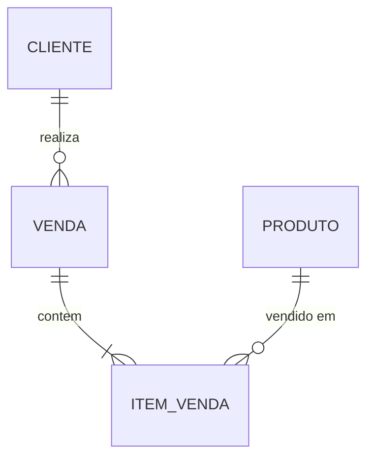

# Atividade Prática – Banco de Dados (FIAP MBA+)

Modelo **CLIENTE / VENDA / ITEM_VENDA / PRODUTO** em **Azure SQL Database**, populado com dados fictícios
(1 milhão de itens de venda, 100 mil vendas, 100 clientes e 100 produtos).

## Estrutura do repositório

```
infra/
  01_criar_instancia.ps1   Passo 1 – cria servidor e banco no Azure (Azure CLI)
sql/
  01_ddl.sql               Passo 2 – estrutura das tabelas (DDL, T-SQL)
  02_consultas.sql         Consultas de exemplo sobre os dados
python/
  gerar_dados.py           Passo 3 – gera e carrega os dados fictícios
  requirements.txt
```

## 1. Instalação – criar a instância do banco

Serviço: **Azure SQL Database**, camada *General Purpose – Serverless* (1 vCore) com a oferta gratuita
(pausa automática ao atingir o limite mensal, sem cobrança), backup local e região `brazilsouth`.

```powershell
az login
.\infra\01_criar_instancia.ps1 -UsuarioAdmin "<usuario_admin>" -SenhaAdmin "<senha forte>"
```

O script executa, em resumo:

```powershell
az group create        -n rg-projeto-sgbd -l brazilsouth
az sql server create   -n sql-projeto-sgbd-<sufixo> -g rg-projeto-sgbd -l brazilsouth -u <usuario_admin> -p <senha>
az sql db create       -g rg-projeto-sgbd -s sql-projeto-sgbd-<sufixo> -n db-projeto-sgbd `
                       --edition GeneralPurpose --compute-model Serverless --family Gen5 --capacity 1 `
                       --use-free-limit --free-limit-exhaustion-behavior AutoPause --backup-storage-redundancy Local
az sql server firewall-rule create -g rg-projeto-sgbd -s sql-projeto-sgbd-<sufixo> -n allow-all `
                       --start-ip-address 0.0.0.0 --end-ip-address 255.255.255.255   # apenas ambiente de estudo
```

Conexão (SSMS, Azure Data Studio ou VS Code): servidor `sql-projeto-sgbd-<sufixo>.database.windows.net`,
porta 1433, autenticação SQL Server, **banco `db-projeto-sgbd`**.

## 2. Estrutura das tabelas (DDL)

O DDL completo está em [`sql/01_ddl.sql`](sql/01_ddl.sql). Resumo do modelo:

| Tabela | Chave primária | Chaves estrangeiras | Atributos |
|---|---|---|---|
| `cliente` | `cod_cliente` | – | 5 (`nome_completo`, `cpf` único, `telefone`, `email`) |
| `produto` | `cod_produto` | – | 5 (`descricao`, `preco_unitario`, `qtd_estoque`, `nome_fornecedor`) |
| `venda` | `cod_venda` | `cod_cliente → cliente` | 5 (`data`, `status`, `total`) |
| `item_venda` | (`cod_venda`, `cod_item`) | `cod_venda → venda`, `cod_produto → produto` | 5 (`quantidade`, `total_item`) |



Atende aos requisitos: 4 tabelas, todas com chave primária, entre 3 e 10 atributos e ao menos um relacionamento.
Há ainda restrições `CHECK` (preço e estoque ≥ 0, quantidade > 0, status válido) e índices nas chaves
estrangeiras para as consultas.

## 3. Como os dados foram gerados

[`python/gerar_dados.py`](python/gerar_dados.py) gera dados fictícios em Python (biblioteca padrão + `pymssql`)
com semente fixa (`--semente 42`), portanto reprodutível:

| Tabela | Registros | Observação |
|---|---|---|
| `cliente` | 100 | nomes combinados de listas, CPFs fictícios com dígitos verificadores válidos e únicos |
| `produto` | 100 | preço de R$ 10 a R$ 2.000, estoque de 0 a 500, 5 fornecedores |
| `venda` | 100.000 | cliente aleatório, data nos últimos 2 anos, status ponderado; `total` já calculado |
| `item_venda` | 1.000.000 | 10 itens por venda, produtos distintos dentro da venda, quantidade de 1 a 10 |

O envio ao banco usa `INSERT ... VALUES` multi-linha em lotes de 1.000 linhas (limite do T-SQL) com commit
periódico; `total` da venda e `total_item` são calculados em Python, sem `UPDATE` posterior. Ao final o
script confere as contagens e a consistência `venda.total = soma dos itens`.

```powershell
cd python
python -m venv ..\.venv
..\.venv\Scripts\pip install -r requirements.txt
$env:DB_PASSWORD = "<senha>"
..\.venv\Scripts\python gerar_dados.py --servidor sql-projeto-sgbd-<sufixo>.database.windows.net --usuario <usuario_admin> --recriar
```

`--recriar` executa `sql/01_ddl.sql` antes da carga; sem ele, o script apenas limpa as tabelas.

Resultado da execução no Azure SQL (serverless 1 vCore, região `brazilsouth`): carga completa em cerca de
5 minutos (`item_venda` ≈ 295 s), 0 divergências nas conferências de integridade e as 12 consultas de
`sql/02_consultas.sql` executando entre 0,0 s e 7 s.

## 4. Consultas

[`sql/02_consultas.sql`](sql/02_consultas.sql) traz 12 consultas: conferência de volume e de integridade,
faturamento por status e por mês, top clientes e produtos, receita por fornecedor (JOIN das 4 tabelas),
detalhe de uma venda, subconsulta/CTE, funções de janela (`RANK`, soma acumulada) e reposição de estoque.
